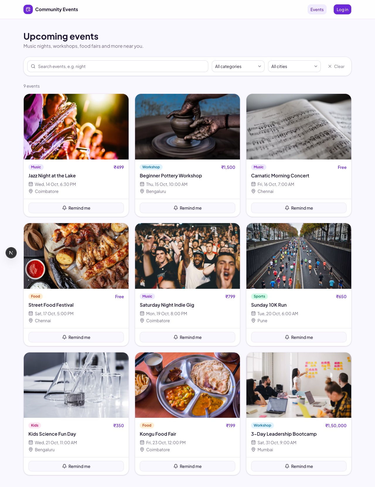
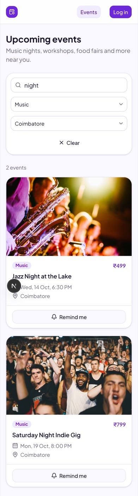
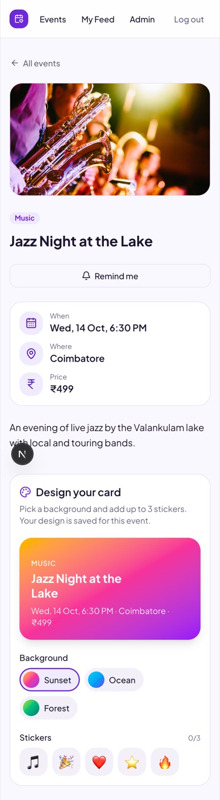
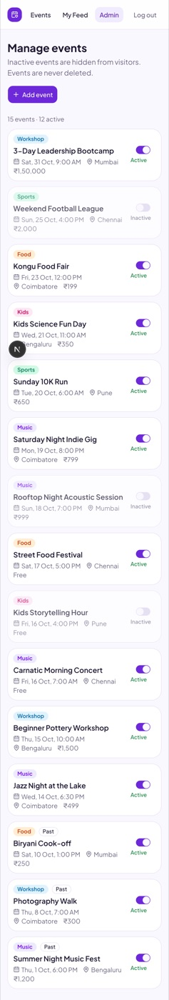

# Community Events Board

A small events app. The admin adds local events, and visitors can browse them, pick favourite categories, set reminders and design a card for an event.

Built with Next.js 16 (App Router), SQLite with Prisma, Tailwind and shadcn/ui. All pages use the app's own JSON API, so a mobile app can use the same API later.

| Laptop | Phone |  |  |
|---|---|---|---|
|  |  |  |  |

## Setup

You need Node.js 20.9 or newer. The database is a SQLite file, so there's nothing else to install.

```bash
git clone https://github.com/jaydippatel83/community-events.git
cd community-events
npm install
cp .env.example .env
npm run db:setup
npm run dev
```

Then open http://localhost:3000.

`npm run db:setup` creates the database and adds the admin and 15 sample events. Event dates are set relative to today, so they're always upcoming. Run `npx prisma db seed` any time to reset the data.

## Admin login

- Email: `admin@events.test`
- Password: `Admin@123`

Visitors can sign up with any email and a password of 8+ characters.

## Sample data

15 events in 5 categories and 5 cities: 9 upcoming, 3 inactive and 3 in the past. Try Music + Coimbatore + "night", which should show 2 events.

## API

Everything returns JSON. Errors look like `{ "error": "message" }`. The token works as a cookie (website) or as `Authorization: Bearer <token>` (mobile).

| Method | Endpoint | Who | What it does |
|---|---|---|---|
| POST | `/api/auth/signup` | anyone | Create account, returns token |
| POST | `/api/auth/login` | anyone | Log in, returns token |
| POST | `/api/auth/logout` | anyone | Log out |
| GET | `/api/me` | user | Current user |
| GET | `/api/events` | anyone | Upcoming events. Filters: `category`, `city`, `q`, `page` |
| GET | `/api/events/cities` | anyone | Cities for the filter dropdown |
| GET | `/api/events/:id` | anyone | One event |
| GET, PUT | `/api/me/favourites` | user | Get or save favourite categories |
| GET | `/api/feed` | user | Upcoming events from favourite categories |
| GET | `/api/me/reminders` | user | Events the user wants reminders for |
| PUT, DELETE | `/api/events/:id/reminder` | user | Turn a reminder on or off |
| GET, PUT | `/api/events/:id/card` | user | Get or save the card design |
| GET, POST | `/api/admin/events` | admin | List all events, add an event |
| PATCH | `/api/admin/events/:id` | admin | Make an event active or inactive |

## Questions

**1. Database structure and why**

```
User (id, email, passwordHash, role)
Event (id, title, category, city, startsAt, pricePaise, description, imageUrl, isActive)
FavouriteCategory (userId, category)
Reminder (userId, eventId)
CardDesign (userId, eventId, theme, stickers)
```

Favourites, reminders and card designs use the pair (userId, eventId or category) as the primary key, so a user can't end up with duplicates. Events have an `isActive` flag because they should never be deleted. I store prices in paise as whole numbers so there are no rounding problems.

**2. How the filter query works, and the index**

The API always filters on `isActive = true` and `startsAt >= now`. Then it adds category, city and the search text (title or description) only if they're given, all joined with AND, so they work together. Results are sorted by date and paged with skip/take. I added an index on `(category, city, startsAt)` and one on `(isActive, startsAt)`.

**3. Passwords and admin protection**

Passwords are hashed with bcrypt, never saved as plain text. Login gives a JWT, which the website keeps in an httpOnly cookie. Admin pages are checked twice on the server, in `proxy.ts` and in the admin layout. Every admin API also checks the token and the role, and returns 401 or 403 if it fails.

## What's left

All the features in the brief are done. With more time I would add:

- Automated tests. I tested the API with curl and the pages by hand on phone and laptop sizes.
- Actually sending reminders (email or notification). Right now they're only saved.
- Rate limiting on login.
- Better text search. SQLite's `LIKE` won't scale for large data.

## Use of AI

I used Claude Code (an AI assistant) to help plan the work, write and debug code, and draft this README. I went through all of it, tested it, and can explain how each part works.
